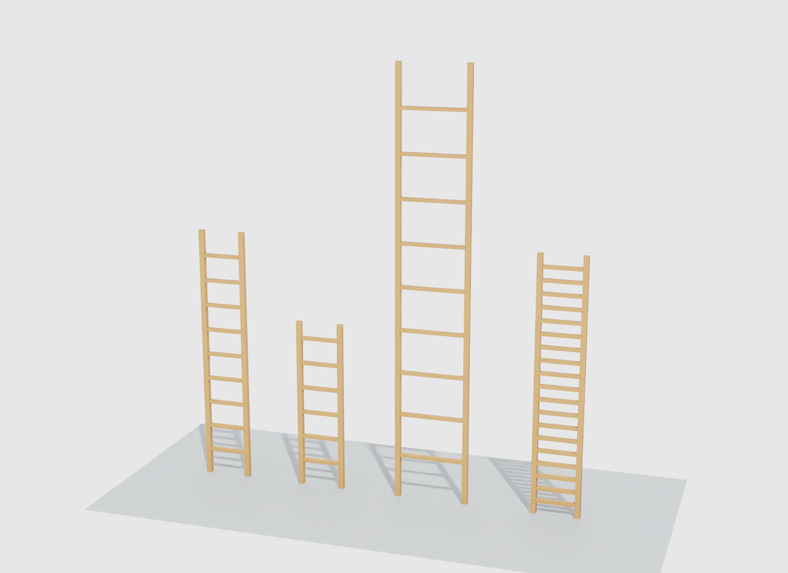

# usdchunks-demo

A Windows workspace for trying [HuginStudios/usd_chunks](https://github.com/HuginStudios/usd_chunks) (1.0.0rc2, alpha), the node-network layer for OpenUSD, on top of NVIDIA's prebuilt OpenUSD. It also includes a procedural ladder tutorial.



*One `ladder_network.usda`, cooked four times with different length, width and rung spacing (rendered with RTX).*

## Requirements

- NVIDIA's prebuilt OpenUSD (25.08) unpacked at `C:\usd_root`. It provides `python.exe`, `usdview`, and `scripts\set_usd_env.bat`.
- git

## Setup

```bat
setup.bat            :: clones usd_chunks at a fixed commit into .\usd_chunks, pip-installs its deps into .\deps
build_examples.bat   :: runs every example in usd_chunks\examples, writing to .\output
usdview_chunks.bat tutorial\ladder_network.usda   :: usdview with the Chunks panel
```

`env.bat` puts USD, usd_chunks (`PYTHONPATH`, `USD_CHUNK_DIRS`) and the usdview plugin (`PXR_PLUGINPATH_NAME`) on the path. Every other script calls it first. To use usd_chunks from your own shell, run `call env.bat`, then `python -m usd_chunks.cli list`.

## Tutorial: a procedural ladder (`tutorial/`)

Three numbers drive the ladder: `Rails.sy` is the length, `Rung.sx` the width, and `Rung.ty` the rung spacing. Expressions inside the network work out everything else: where the rails sit, how many rungs fit, and the height of each rung.

| File | What it is |
|---|---|
| `ladder.py` | Builds the 10-chunk network with the `Scene` API and writes `ladder_network.usda` and `ladder.usda` |
| `ladder_network.usda` | The network itself (Chunk prims plus expressions) |
| `ladder.usda` | The cooked result as plain USD (2 rails, 9 rungs) |
| `variants.bat` | Cooks the saved network again with CLI overrides, writing `ladder_short`, `ladder_tall_wide` and `ladder_dense.usda` (6, 9 and 19 rungs) |
| `compose.py`, `cam.py`, `lights.py` | Build `ladder_preview.usda` and `ladder_cam.usda` (four ladders, a floor, a camera and lights) for rendering |
| `box.py` | The upstream three-chunk box example, kept for comparison |

```bat
cd tutorial
run_ladder.bat ladder.py
variants.bat
```

Vector params such as `copy_translate` take only a whole-vector expression (`@Node.vec@`), so the network uses two Vector Math nodes (`Gap`, `Rise`) to turn the width and spacing into vectors.

## Docs (`docs/`)

Open these in a browser:

- `how_it_works.html` explains how usd_chunks works, using the ladder throughout. It covers chunk prims, the cook and layer stack, the two kinds of wires, groups and hosts.
- `examples_guide.html` walks through the examples that ship with usd_chunks and how each one uses it.

## Not in this repo

`usd_chunks/`, `deps/` and `output/` are fetched or generated by the scripts above. usd_chunks is Apache-2.0 © HuginStudios.
